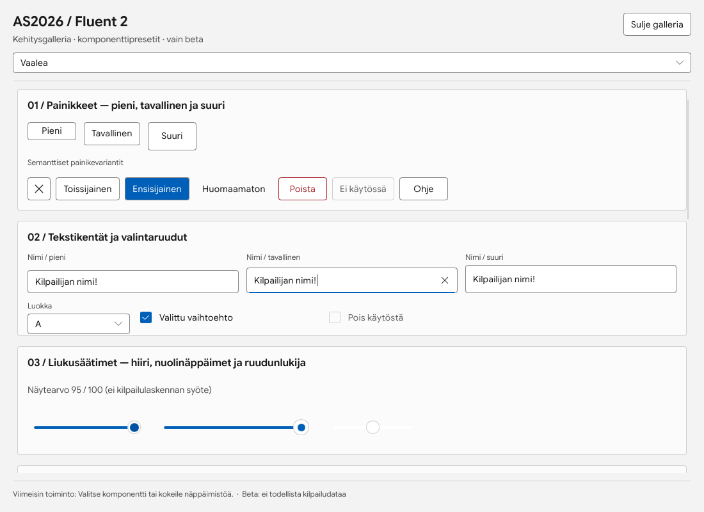
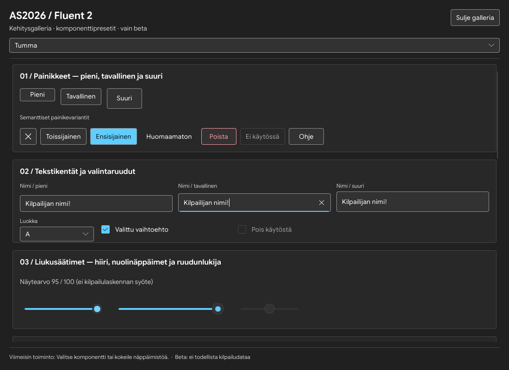

# AS2026 Fluent 2 -komponenttigalleria (beta)

> **Vain** `beta/fluent2-v071`-kehityshaarassa. Ei kilpailupäivän käyttöön, ei valmista UI-uudistusta eikä oikeaa kilpailudataa. Ei saa yhdistää `main`-haaraan ilman omistajan hyväksyntää.

## Käynnistä

Linux (X11/Wayland) tai Windows Rustin MSVC-ympäristö:

```sh
cargo run --locked --features gui --bin as2026-gui -- --fluent-gallery
```

Jos haluat samalla automaattisen PNG-tarkistuskuvan (ohjelmistorenderöinnillä):

```sh
cargo run --locked --features gui --bin as2026-gui -- --fluent-gallery --capture-dir /tmp/as2026-fluent-gallery
```

Windowsissa viimeinen polku vaihdetaan esimerkiksi `C:\\Temp\\as2026-fluent-gallery`. Kuva tallentuu hakemistoon nimellä `fluent-gallery.png`. **Kuvakaappaus otetaan kerran**, ja se ei yksin testaa toiminnallista näppäimistö- tai hiirikäyttöä. Tämä developer-only `--fluent-gallery`-valinta ei avaa viimeksi käytettyä kilpailua.

## Mitä galleria näyttää

- Pienet (28 px), tavalliset (36 px) ja suuret (44 px) **UiButton**-kontrollit.
- Semanttiset **standard**, **primary**, **subtle** ja **danger**-painikevariantit sekä käytöstä poistettu painike.
- **UiTextField**-kentät kolmessa koossa, **UiComboBox** ja **UiCheckBox**.
- **UiSlider** kahdessa koossa, arvolla 0–100 ja step 5, sekä käytöstä poistettu slider.
- **UiScrollView**-vieritys ja pitkä sisältö erillisen scrollbar-invariantin testaamiseen.
- Tehostevalinta ja neljä ulkoasua: galleriassa vain muistissa. Ei lue tai kirjoita käyttäjäasetuksia. Oletus on pois.

Komponentit sijaitsevat yhdessä tiedostossa `ui/presets.slint`. Tämä galleria on `ui/fluent-gallery.slint`. Esiasetus-koot ovat **AS2026:n omia projektipäätöksiä**, eivät automaattisesti virallisia Microsoft-mittoja. Yksityiskohdat löytyvät [Fluent 2 -komponenttistandardista](FLUENT2_KOMPONENTTISTANDARDI.md).

## Käyttöliittymätoteutuksen rajoitteet

`UiSlider` perii Slint 1.18.1:n Sliderin ja käyttää AS2026:n koko-, fokus- ja askelsovitusta: rajattu liukualue, päätypisteet, nuolinäppäimet, screen-readerin min/max/step-arvot. Sitä **ei saa käyttää pisteisiin, Emit-virheisiin, tarkkoihin kellonaikoihin, lähtöväleihin tai muihin kilpailutuloksiin**. Niille käytetään täsmällistä tekstisyötettä tai (myöhemmin) SpinBoxia.

Preset-kirjaston ensisijainen toteutusstrategia on **periä Slintin jo toimiva, saavutettava kontrolli**. UiButton/UiTextField/UiComboBox/UiCheckBox/UiScrollView eivät saa menettää aiempia callbackeja, keskeisiä näppäintoimintoja tai toiminnon tilaa.

**Huom.** Uuden kirjaston käyttöönotto varsinaisilla kilpailusivuilla on erillinen vaihe. Galleria **ei todista** valaistujen Windows-materialien, kaikkien teemojen tai kaikkien myöhemmin lisättävien komponenttien toteutusta.

## Vaadittu QA ennen pääsivuille siirtymistä

1. `cargo fmt --all -- --check`, `cargo test --locked --all-targets`, `cargo test --locked --all-targets --features gui` ja `cargo clippy --locked --all-targets --features gui -- -D warnings`.
2. Käynnistä galleria Linuxilla ja Windowsilla; varmista että säädinten koko muuttuu oikeasti, variantit ja fokus ovat havaittavia myös ilman animaatioita.
3. Näppäimistö: Tab/Shift+Tab, Space/Enter-painikkeet, CheckBox, ComboBox sekä sliderin nuoli/Home/End. Älä hyväksy hiiren pintaosuuden perusteella tehtyä pelkkää kuvallista arviota.
4. Hiiri: hover/pressed/disabled, sliderin painallus ja veto, ScrollView:n pyörä ja thumb, pitkät suomenkieliset labelit.
5. 900×600, 1280×800, 1920×1080; 100 % ja 150 % skaalaus. Vertaa WinUI 3 Galleryn ja Windows UI Kitin viitteisiin.
6. `Theme.effects-enabled=false` on oletus. Kun checkbox kytketään päälle, vain todelliset tuetut efektit voivat käynnistyä. Varmista ettei mikään tehoste käynnisty off-tilassa.
7. Tarkista samalla, että tavalliset `as2026-gui --demo` -toiminnot ja kilpailupäivän GUI-smoke eivät muutu.

## Automaattinen gallerian työnkulkukoe

```sh
cargo run --locked --features gui --bin as2026-gui -- --gallery-smoke-test --capture-dir /tmp/as2026-gallerian-koe
```

Koe lähettää oikeita Slint-ikkunan näppäin- ja hiiritapahtumia. Se tarkistaa liukusäätimen nuoli/Home/End-näppäimet ja askelen, ettei hiiren pelkkä liike muuta arvoa, valintaruudun välilyöntikytkennän sekä tekstisyötteen, kytkimen välilyöntitoiminnon ja numerosäätimen nuolinäppäimet. Hiiren painallus tarkistaa liukusäätimen askelluksen. Sisällön supistuminen rajaa vierityksen; laajentuminen ei vieritä. Lisäksi tallennetaan neljä teemaa tehosteet pois/päällä, lisäkomponentit ja 900×600-ikkuna. Valikkopainikkeen Enter/Esc-koe tarkistaa myös todellisen `PopupWindow.is-open`-tilan. Tämä ei vielä kata kaikkia ohjaimia eikä korvaa Windowsin visuaalista vertailua. Gallerian käynnistys hylkää kilpailu- ja asennusvalintojen yhdistämisen.

## Seuraava vaihe

Kun gallerian Windows/Linux-testaus on läpäisty: migroi yksi sovelluksen todellinen sivu kerrallaan yhteisiin Ui-presetteihin, aloita painikkeista ja syötekentistä. Pidä vanhat sovelluksen callbackit, mallin data ja kilpailutoimintojen logiikka ennallaan.

## Todelliset tarkistuskuvat

Linuxin Slint-ohjelmistorenderöinti, 100 %, 1100×800, 25.10.2026. Nämä ovat AS2026:n beta-kuvia; eivät Microsoftin referenssikuvia tai todiste WinUI-pikselivastaavuudesta.





Nykyinen ulkoasuvalikoima: [10 vaihtoehtoa ja teemojen sävyt](TEEMAT.md).
