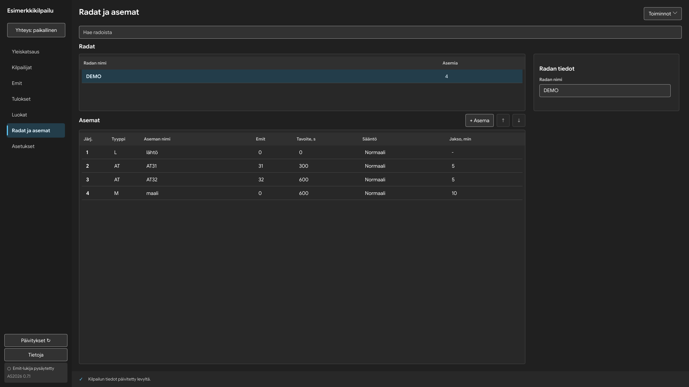
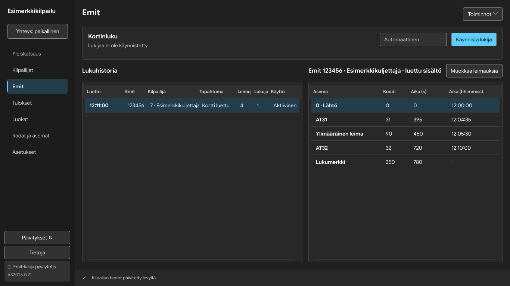
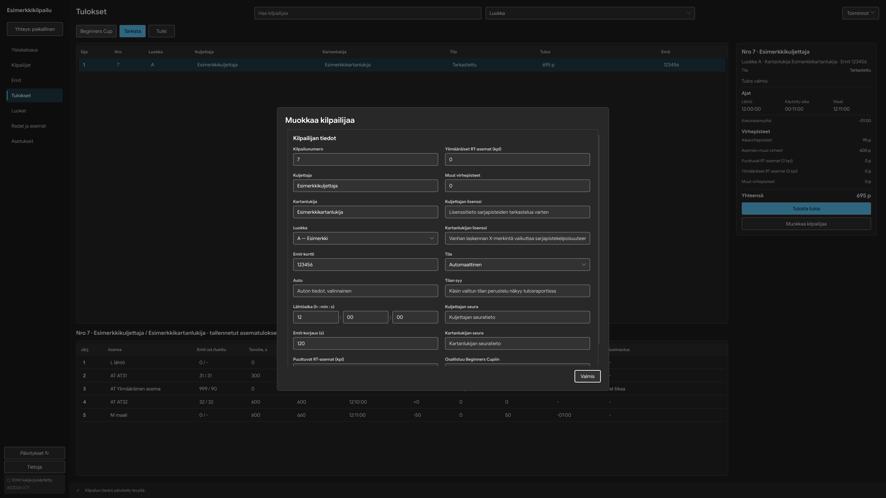
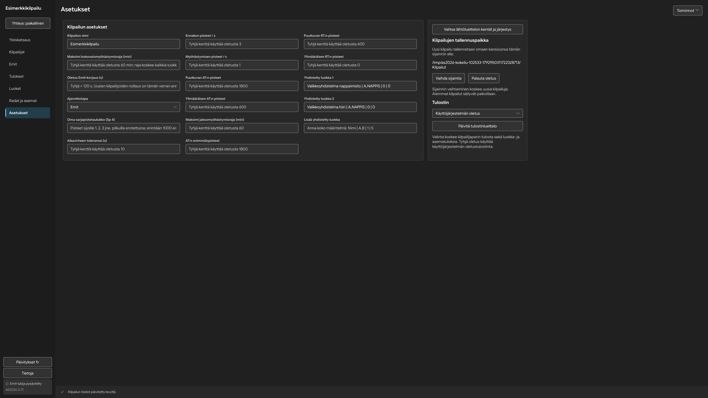
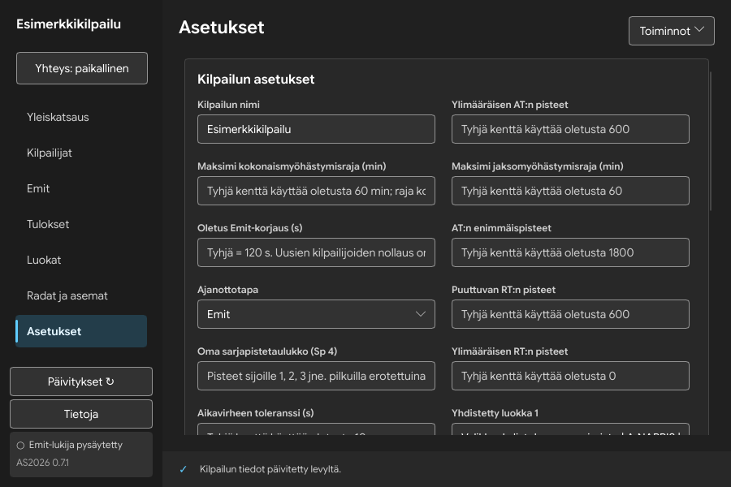
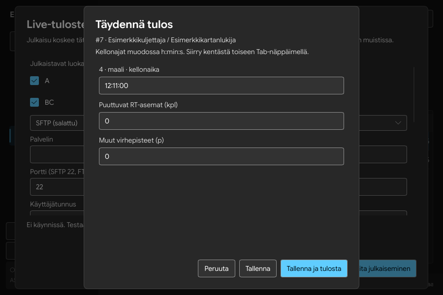

# AS2026:n Slint-käyttöliittymäopas

Tämä opas kuvaa AS2026 0.7.3:n käyttöliittymää. Kilpailusäännöt, ajanoton yksiköt, hyväksyntöjen säilyttäminen ja Emit-editorin toiminta säilyvät ennallaan. Katso myös [kilpailun työvaiheet](KILPAILUTOIMINNOT.md) ja [yhteiset käyttöliittymäperiaatteet](UI_PERIAATTEET.md).

## Ulkoasun yhteiset arvot

Tietoja-ikkunan **Ulkoasu**-valinnalla voit käyttää järjestelmän mukaista, vaaleaa, tummaa tai vihreää **Tumma kuusi**-, puunsävyistä **Hiillos**- tai lohenpunaisella korostettua **Shanghai**-ulkoasua. Valinta tallentuu tämän tietokoneen sovellusasetuksiin. Se ei muuta kilpailua tai muiden LAN-koneiden ulkoasua. Järjestelmän mukainen tila seuraa käyttöjärjestelmän Slintille ilmoittamaa vaaleaa/tummaa tilaa; tuntematon tila käyttää vaaleaa.

**Ota animaatiot ja tehosteet käyttöön** on erillinen valinta samassa ikkunassa. Oletus on pois. Perustoiminnot, valinta ja näppäimistöfokus toimivat myös ilman tehosteita. Windowsin Mica/Acrylic-taustamateriaaleja ei ole toteutettu.

Säätimen oletuskorkeus on 36 loogista pikseliä, taulukkorivin 38, sivumarginaali 20 ja paneelin sisämarginaali 16. Välit seuraavat neljän pikselin asteikkoa. Otsikko on 22, osion otsikko 16, perusteksti 14 ja pienet tekstit vähintään 12 pikseliä. Värit ja mitat tulevat yhdestä [teemasta](../ui/theme.slint).

Valintaikkunan alla näkyy neutraali musta peite. Taustasta ei oteta tilannekuvaa eikä sitä sumenneta. Varsinaiset paneelit ja kentät ovat peittäviä; työpöydän väri ei muuta niiden kontrastia. Pitkät lomakkeet vierivät oman sisältöalueensa sisällä. **Seurat ja lisenssit** -osion sulkeminen rajaa vierityskohdan sisällön uusiin rajoihin; avaaminen ei vieritä itsestään.

## Sivut ja niiden tarkoitus

| Sivu | Näkyvä rakenne | Keskeiset toiminnot |
|---|---|---|
| Yleiskatsaus | Kilpailun tunnusluvut ja työvaihelinkit; ilman kilpailua aloituskortti | Avaa, uusi ja Excel-tuonti Mikky100:n Toiminnot-valikossa; esimerkkikilpailu erikseen |
| Kilpailijat | Haku, kilpailijataulukko, valitun kilpailijan tiedot | Lisäys ja lähtöarvonta Toiminnot-valikossa; lähtöluettelo valituilla sarakkeilla |
| Emit | Kortinluku, lukuhistoria ja kortin sisältö | Lukijan käynnistys/pysäytys, aktiivisen kortin leimausten muokkaus |
| Tulokset | Haku ja luokkarajaus, tulosluettelo, asematulokset ja yhteenveto | Tarkista, Tutki, huomautukset; vienti ja tulostus Toiminnot-valikossa |
| Luokat | Luokkataulukko ja luokan tiedot | Lisää luokka, lisää yhdistetty luokka, Beginners Cup; luokan poisto tiedoissa |
| Radat ja asemat | Rataluettelo, asemat ja valitun kohteen tiedot | Radan tuonti/lisäys valikossa, asemien lisäys ja järjestys |
| Asetukset | Kilpailun asetukset sekä tallennus-, tulostin- ja lähtöluettelovalinnat | Automaattinen tallennus; laskenta-asetusten yksiköt säilyvät ennallaan |

Sivupalkin kilpailunimi ja yhteystila ovat Mikky100:n sijoittelun mukaiset.
Pitkä LAN-tilateksti lyhenee sivupalkissa ja koko teksti on saavutettavassa
nimessä sekä yhteysikkunassa. Sivupalkki vierii lyhyessä ikkunassa.

## Yhteisten komponenttien kartta

Lähde: [ui/components.slint](../ui/components.slint).

| Slint-komponentti | Miltä se näyttää | Käyttäytyminen ja käyttö |
|---|---|---|
| `Heading` | Vaalea 22 px lihavoitu otsikko | Sivun tai valintaikkunan pääotsikko |
| `Note` | Hillitty 14 px rivittyvä teksti | Lyhyt lisätieto; ei pitkää pysyvää ohjeseinää |
| `AccentButton` | Vihreä Fluent-painike | Ensisijainen toiminto; sama kohdistus ja käytöstäpoisto kuin muilla painikkeilla |
| `Workspace` | Luettelo ja tietopaneeli rinnakkain tai välilehtipainikkeet | Alle riittävän työtilan näytetään yksi pääalue kerrallaan |
| `DialogSurface` | Keskitetty tumma kortti, ohut reunus, pyöristetyt kulmat | Ikkunan reunoille vähintään 12 px, sisään 24 px; sisältö rajoitetaan ikkunaan |
| `DialogActions` | Oikealle tasattu painikeryhmä | Peruuta vasemmalla, vahvistus oikealla; ryhmä pysyy vierityksen ulkopuolella |
| `NavItem` | Vasemman reunan navigaatiorivi ja vihreä valintapalkki | Hiiri, Enter ja Space avaavat sivun |
| `FormField` | Nimi ylhäällä; tekstikenttä, valikko tai h:min:s-kentät | Kelvollinen muutos tallentuu Enterillä tai kentästä poistuttaessa; Enter poistaa kohdistuskorostuksen, virhe jää korjattavaksi |
| `DataTable` | Tumma otsikkorivi, tasakorkuiset tietorivit, vihreä valinta | Pystyvieritys oikealla; leveän taulukon vaakavieritys kuljettaa otsikot ja rivit yhdessä |
| `EditorEntry` | Yksi `FormField`-kenttä mallista | Välittää olemassa olevat kenttätunnukset ja tallennuskutsut |
| `EditorFields` | Kenttäryhmä yhdessä tai useammassa palstassa | Sama kenttämalli; asemien ja kilpailijan omat ryhmittelyt säilyvät |
| `Editor` | Reunustettu tietokortti, otsikko ja kentät | Kenttävirheet, automaattinen tallennus, luonnoksen tyhjennys ja Mikky100:n luokan poisto |
| `Metric` | Suuri luku ja hillitty selite | Yleiskatsauksen kilpailija-, luokka-, rata- ja lukumäärät |
| `ChoiceRow` | Nimetty valintaruuturivi | Tab/Shift+Tab, Space ja hiiri; valinta näkyy ilman pelkkään väriin luottamista |

## Valintaikkunat ja tuloskomponentit

| Lähde ja komponentti | Näkyvä sisältö | Olennainen toiminta |
|---|---|---|
| [app.slint](../ui/app.slint): `AppWindow` | Sivupalkki, sivun työalue, tilapalkki ja sisäiset valintaikkunat | Navigaatio, tiedoston avaus/uusi, LAN, tuonti, vienti, huomautukset, asennus ja vahvistukset |
| [results.slint](../ui/results.slint): `ResultSummary` | Kilpailijan tila, ajat, virhepisteet, yhteensä ja toimintopainikkeet | Tulostus ja kilpailijan muokkaus; ei omaa rinnakkaista pistelaskentaa |
| `ResultPoint` samassa tiedostossa | Selite vasemmalla, arvo oikealla | Yhden tulossumman esitys |
| [live-publish.slint](../ui/live-publish.slint): `LivePublishDialog` | Keskitetty tumma ikkuna, yhteystapa, nimetyt palvelinkentät ja lähetyksen tila | Vieritys pienessä ikkunassa, salasanan peittäminen, erilliset testaus/aloitus/lopetus/lopullinen julkaisu; [käyttöohje](LIVE_JULKAISU.md) |
| [result-entry.slint](../ui/result-entry.slint): `ResultEntryDialog` | Käsikellot ja virhepisteet sekä tulostus | Mikky100:n hyväksyntä- ja tulostuspolku; virhe pysyy lomakkeessa |
| `EntryLine` samassa tiedostossa | Yksi nimetty kellon tai pisteiden syöterivi | Looginen Tab-järjestys ja näkyviin vieritys |
| [emit-correction.slint](../ui/emit-correction.slint): `EmitCorrectionDialog` | Koko aktiivisen kortin leimaukset kiinteinä kenttäryhminä | Mikky100:n lisää/poista/palauta alkuperäiset -toiminnot ja kellonaikamuokkaus; raakalukema säilyy |
| `CorrectionField` samassa tiedostossa | Yksi leiman kenttä | Välittää muokkauksen editorin luonnokseen; peruuttaminen ei kirjoita korttia |
| [draw-classes.slint](../ui/draw-classes.slint): `DrawClassDialog` | Arvontaan osallistuvien luokkien valinnat | Joukkovalinnat, vieritys ja näppäimistö |
| [combined-class.slint](../ui/combined-class.slint): `CombinedClassDialog` | Nimi, jäsenluokat ja pisteasetukset | Luonti, muokkaus, validointi ja peruutus |
| [beginners-cup.slint](../ui/beginners-cup.slint): `BeginnersCupDialog` | Lähderata, asemat ja osallistujat | Valintojen tallennus olemassa olevaan BC-malliin |
| [print-classes.slint](../ui/print-classes.slint): `PrintClassesDialog` | Luokkavalinnat ja tulostusasetukset | Luokka- tai asematuloste; luokkarajauksen käsittely säilyy Mikky100:n mukaisena |
| [start-columns.slint](../ui/start-columns.slint): `StartColumnsDialog` | Lähtöluettelon sarakkeiden valinnat ja järjestys | Mikky100:n toteutus; näyttöasetukset eivät poista tulosten hyväksyntää |
| [types.slint](../ui/types.slint) | Ei piirrettyä sisältöä | Rustin ja Slintin yhteiset tietorakenteet, ei ulkoasun toteutus |

## Fluent-perussäätimet

Paikallinen sovitus on [ui/fluent/style](../ui/fluent/style) ja sen
[ylläpito-ohje](../ui/fluent/README.md). `Button` piirtää tavallisen, ensisijaisen,
valitun ja käytöstä poistetun tilan. `LineEdit` piirtää tekstikentän ja
kohdistusreunan. `ComboBox` piirtää valitun arvon, nuolen ja alapuolelle
avautuvan valikon. `CheckBox` piirtää nimellisen valintaruudun. `ScrollView`
ja `ListView` huolehtivat vierityksestä. `MenuBorder`, `ListItem` ja
`FocusBorder` ovat valikoiden pinta, rivi ja kohdistuskehys. Näitä ei korvata
sivukohtaisilla kopioilla. `AboutSlint` säilyttää kirjaston tunnisteen.

### Fluentin sisäiset osat

Näitä osia ei tarvitse käyttää suoraan sovelluksen sivuilla. Ne selittävät,
mistä perussäätimien näkyvät osat ja käytös muodostuvat.

| Komponentti | Ulkoasu / tehtävä |
|---|---|
| `ScrollViewButton`, `ScrollBar` | Vierityspalkin nuolen hiirialue ja palkki; oma kaista estää sisällön peittymisen |
| `MenuBarItem`, `MenuBar` | Valikkopalkin teksti ja vaakasuuntainen valikkoryhmä |
| `MenuFrame`, `MenuItem` | Ponnahdusvalikon tumma reunustettu kehys ja yksittäinen valittava rivi |
| `PopupMenuImpl`, `MenuBarImpl` | Slintin sisäinen valikkoikkuna ja sen välitys; eivät sivukohtaisia uusia kortteja |
| `MenuBarItemBase`, `MenuBarBase`, `MenuFrameBase`, `MenuItemBase` | Valikoiden pohjatoiminta; lopulliset värit ja reunat tulevat style-tiedostoista |
| `StandardListViewBase`, `StandardListView` | Yksinkertainen vakiorivilista vieritysalueessa; AS2026:n kilpailutaulukot käyttävät omaa `DataTable`-komponenttia |
| `LineEditBase` | Tekstin syöttö, kohdistus, valinta ja tekstin kontekstivalikko; näkyvä pinta tulee `LineEdit`-sovituksesta |
| `LineEditClearIcon`, `LineEditPasswordIcon` | Tekstin tyhjennyksen ja salasanan näyttämisen pienet kirjastokuvakkeet silloin, kun säädin käyttää niitä |
| `ComboBoxBase` | Valinnan ja näppäinten pohjatoiminta; sovitus piirtää kentän, nuolen ja popupin |

### Slintin rakennuspalikat

| Elementti | Näkyvä tehtävä sovelluksessa |
|---|---|
| `Window`, `PopupWindow` | Pääikkuna ja hetkellinen valikko; popup ei ole kilpailutiedon omistaja |
| `Rectangle` | Tausta, paneeli, reunus, erotin tai tilanvaraus Theme-väreillä |
| `Text`, `TextInput` | Otsikko/selite/arvo ja muokattava teksti; varsinaiset kentät käyttävät yhteisiä säätimiä |
| `Image`, `Path` | Kirjaston kuvake tai Slint-tunnus; eivät snapshot-taustoja |
| `HorizontalLayout`, `VerticalLayout`, `GridLayout` | Rivin, palstan ja ruudukon mitoitus; eivät itse piirrä pintaa |
| `FocusScope` | Näppäimistön kohdistuksen omistaja, ei näkyvä laatikko |
| `TouchArea` | Hiirialue tai modaalin taustan painallusten esto, ei itsenäistä ulkoasua |
| `Flickable` | Vierivän sisällön perusta; käyttöliittymässä sen päällä yhteinen vierityspinta |
| `if`, `for` | Ehdollinen tai mallista toistuva sisältö. Ehdollinen valikkopainike voi tuhoutua heti popupin sulkeutuessa |
| `Theme`, `Palette`, `FluentPalette` | Väri- ja mitta-arvot; eivät näkyviä käyttöliittymäelementtejä |

## Koonvaihto ja tarkistus

Tuettu vähimmäiskoko on 900 × 600 loogista pikseliä. Fyysinen 150 prosentin
skaalaus tarvitsee vastaavasti enemmän näyttöpikseleitä. Kenttiä ei kutisteta
alle käyttökelpoisen koon: työalue vaihtaa rakennetta tai vierii. Suurella
näytöllä asetukset hyödyntävät useampaa palstaa, mutta lukuleveys pysyy rajattuna.

Tarkista jokaiselta sivulta hiiri, Tab, Shift+Tab, Enter, Space, Esc,
pysty-/vaakavieritys, kenttävirhe ja palautuminen. Valintojen ja dialogien
kuvat ovat todellisia synteettisen kilpailun kuvakaappauksia, eivät mallikuvia.
Alla olevat kuusi kuvaa on otettu 0.7.0:n natiivista Slint-sovelluksesta
Linux-virtuaalinäytössä synteettisellä kilpailulla. Valikkokoe suoritti 52
hiiri- ja näppäimistövalintaa, mukaan lukien luokkien lisäykset ja tulosviennit.
Kuvat todistavat nämä näkymät ja kokeessa suoritetut polut; ne eivät yksin
todista koko testimatriisin, fyysisen Emit-lukijan tai paperitulostimen toimintaa.

LAN-ohje: [yhteiskäyttö ja palautuminen](LAHIVERKKO.md),
[Windowsin ja UFW:n palomuuri](PALOMUURI.md).

## Todelliset betan tarkistuskuvat

Kuvat on tuotettu 25.10.2026 Linuxin eristetyssä Slint-ohjelmistorenderöinnissä synteettisellä kilpailulla. Ne eivät ole WinUI 3 -referenssikuvia eikä niiden perusteella väitetä Windowsin pikselivastaavuutta.

### Luokan lisääminen

Toiminnot → Lisää luokka avaa olemassa olevan editorin. Tunnus ja nimi
viimeistelevät automaattisesti tallentuvan uuden luokan. Yhdistetyn luokan
oma ikkuna säilyy Mikky100:n toteutuksena.

### Rataluettelo ja radan tiedot

Tietokortti alkaa samalta korkeudelta kuin rataluettelon pinta.
Tietokortin ja luettelon alareunat ovat rinnakkaisnäkymässä samalla
korkeudella. Otsikko kuuluu luettelon yläpuolelle; asemien oma toimintorivi säilyy erillisenä.

### Emit-historia ja luettu sisältö

Yhteinen otsikkorivi pitää molemmat taulukot samalla korkeudella.
Muokkaa leimauksia avaa Mikky100:n koko kortin editorin. Alkuperäiset
lukemat ja korjaukset säilyvät hänen tietomallissaan.

### Kilpailijan muokkaus

Keskitetty ikkuna, kahden palstan lomake riittävän leveässä tilassa,
pysyvä Valmis-painike ja vierivä sisältö. Valmis, Esc ja sama muokkauskutsu
sulkevat ikkunan vain, kun nykyinen validointi sallii sen. Tausta on näkyvissä
neutraalisti tummennettuna. Mikky100:n Emit-korjauksen sekuntiyksikkö säilyy.

### Asetukset leveässä ja pienessä ikkunassa

Kolme tasalevyistä kenttäpalstaa suurella näytöllä, oikealla yhteiset
sovellusasetukset. Pienessä ikkunassa sivu vierii; kaikkia asetuksia ei
puristeta yhdelle ruudulle. Tab-järjestys etenee palstan alusta loppuun
ja seuraavan palstan alkuun.

### Aloitus ilman kilpailua

Rajattu aloituskortti ja Mikky100:n Toiminnot-valikko. Avointa kilpailua
edellyttäviä taulukoita ei näytetä tyhjinä työalueina.

### Lähiverkon isäntänäkymä

Parituskoodi on erotettu omaksi selkeäksi pinnakseen. Osoite, tila ja
lopettaminen ovat erillisiä. PIN-koodi on nelinumeroinen ja epäonnistuneita yrityksiä rajoitetaan; ulkoasu ei
lyhennä yhteyden salaisuutta. Liittymiskenttien Enter tekee saman kuin
Yhdistä kilpailuun.

### Livejulkaisu pienessä ikkunassa

Luokkavalinnat ja palvelinkentät vierivät, mutta julkaisutila ja alapainikkeet
pysyvät näkyvissä. Paikallinen live ja palvelinjulkaisu ovat erillisiä toimintoja.
Yhteyskoe ei kirjoita tuloksia palvelimelle.

## Kokeiden toistaminen

Normaali GUI-työnkulkukoe: `as2026-gui --demo --smoke-test --capture-dir KANSIO`.
Valikkokoe: sama ohjelma valinnoilla `--demo --capture-dir KANSIO` ja
ympäristömuuttujalla `AS2026_MENU_GUI_TEST=1`. Käytä uutta tyhjää kuvakansiota:
vienti ei korvaa olemassa olevia tiedostoja. Koe toimii vain synteettisessä
demokilpailussa. Se käyttää oikeaa käännettyä Slint-käyttöliittymää ja tuotannon
avaus-, tuonti-, vienti- ja tulostekoodia. Ainoastaan käyttöjärjestelmän
natiivi tiedostovalitsin saa ennalta määrätyn synteettisen polun. Tuloste
muodostetaan muistiin lähettämättä sitä fyysiselle tulostimelle.

Valikkokoe käy sivukohtaiset valinnat hiirellä ja Tab/Enterillä, tallentaa
luokat, avaa ne uudelleen, vie kolme tiedostomuotoa sekä ottaa kaikki seitsemän
sivua neljässä koossa. Se tarkistaa myös BC-valinnan palautumisen,
muokkausikkunan sulkemisen, neutraalin taustapeitteen pikselit, aloituspolut
ilman kilpailua sekä käytöstäpoistotilat. Molempien alustojen CI ajaa lisäksi
vanhat 100 % / 150 % GUI-työnkulut ja Emit-editorin kokeen. Fyysinen Emit-lukija,
käyttöjärjestelmän tiedostovalitsimen ulkoasu ja paperituloste vaativat
edelleen erillisen laitekokeen.

## Muut pääsivut

Yleiskatsaus käyttää tunnuslukuja (`Metric`) ja työvaihepainikkeita.
Kilpailijat ja Luokat käyttävät samaa `DataTable` + `Editor` -työaluetta.
Tulokset lisää `ResultSummary`-kortin ja asematulostaulukon; haku ja
luokkarajaus säilyvät Mikky100:n otsikkorivillä.

## Peräkkäiset Emit-kortit

Koskematon Täydennä tulos -ikkuna seuraa uutta korttia suoraan. Jo aloitettu
syöttö säilyy; ikkunan ohjeteksti nimeää odottavan kilpailijan. Tallentaminen tai
peruuttaminen avaa seuraavan kortin tuloksen. Raakaleimat säilyvät nykyisessä
Emit-historiassa.

## Kentän vahvistaminen ja yhteyspainike

Tavalliseen muokkauskenttään kirjoitetun kelvollisen arvon Enter tallentaa
ja siirtää kohdistuksen pois kentästä. Kentän aktiivinen alareuna häviää,
mutta dialogi pysyy avoinna. Virheellinen arvo jää korjattavaksi. LAN-liittyminen,
vientitiedoston tallentaminen ja tulosdialogin painikkeet säilyttävät omat
Enter-toimintonsa; yleinen lomakekäytös ei korvaa niitä.

Sivupalkin yhteystila on tavallinen Fluent-painike. Sen leveys ja korkeus
seuraavat navigoinnin mittoja. Pitkä tila lyhenee painikkeessa, ja koko tila
on luettavissa yhteysikkunasta. Alareunan virhetekstillä ei ole erillistä
Näytä virhe -painiketta.

## Kehittäjän komponenttikartta

Käyttäjän työvaiheet ovat yllä. Toteuttajalle ensisijainen lähde on [komponenttistandardi](FLUENT2_KOMPONENTTISTANDARDI.md). `ui/presets.slint` kokoaa yhteiset säätimet; varsinaiset sivut tuovat ne myös vanhoilla Button/LineEdit/ComboBox/CheckBox/ScrollView-nimillä, jotta niiden tapahtumasopimukset säilyvät. `ui/components.slint` säilyttää kilpailutaulukot, listan ja tietojen työtilan sekä modaalipinnan. `src/gui` vastaa yhteydestä olemassa olevaan kilpailuytimeen.

[Kehitysgalleria](FLUENT2_GALLERIA.md) käynnistyy erikseen eikä avaa kilpailuja, käyttäjäasetuksia, tulostinta tai Emit-lukijaa. Gallerian ulkoasu- ja tehostevalinnat häviävät sulkemisessa. Tämä poikkeaa varsinaisen sovelluksen tallentuvista valinnoista.

## Päivitystarkistus käynnistyessä

Sovellus tarkistaa saatavilla olevan vakaan version automaattisesti taustalla tavallisen käynnistyksen jälkeen. Tarkistus vastaa sivupalkin Päivitykset-painiketta eikä estä kilpailun käyttöä. Päivitystä ei ladata tai asenneta automaattisesti: saatavilla olevan version asentaminen valitaan erikseen sivupalkista. Ilman verkkoyhteyttä kilpailun paikallinen käyttö jatkuu normaalisti. Päivitykset-painikkeesta tarkistuksen voi uusia myöhemmin.

## Radan ja aseman tiedot

Radat ja asemat -sivulla asemat näkyvät ylhäällä ja radat-lista alhaalla. Valitse rata alalistasta. Aseman rivi avaa aseman muokkauksen keskitettyyn ikkunaan; Valmis tai Esc sulkee sen validoinnin salliessa. Uusi asema avataan + Asema -painikkeesta. Radan tiedot -painike avaa valitun radan nimen omaan ikkunaan.
