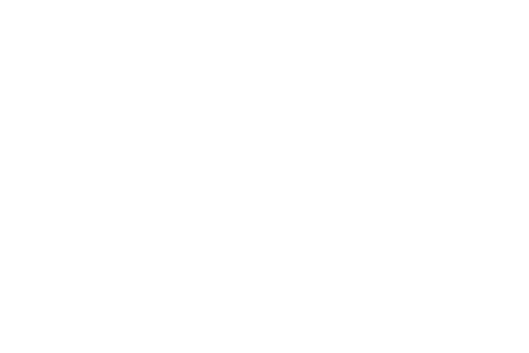

# Paikalliset livetulokset ja SFTP/FTP-julkaisu

Avaa **Tulokset → Toiminnot → Live-tulosten julkaisu**. Sivun voi linkittää
WordPressin tapahtumaan, artikkeliin tai sivulle tavallisena linkkinä. Erillistä
WordPress-lisäosaa tai AS2026:lle avattavaa saapuvaa internet-yhteyttä ei tarvita.

## Ennen aloittamista

Pyydä palvelimen ylläpitäjältä yhteystapa, palvelin, portti, käyttäjätunnus,
kohdehakemisto ja julkinen osoite. Varmista oikeus korvata valittu tulostiedosto.
SFTP tarvitsee lisäksi palvelimen SHA256-heksasormenjäljen. WordPress-linkin
lisäämisestä ja mahdollisen CDN:n asetuksista sovitaan sivuston ylläpitäjän kanssa.
AS2026 ei muuta WordPressiä eikä julkaise mitään pelkän yhteystestin perusteella.

Valitse **yksi julkaiseva kone kilpailua kohti**. LAN-koneiden kaikki tulokset
välittyvät sille normaalin synkronoinnin kautta. Älä käynnistä rinnakkaisia
julkaisijoita samaan palvelintiedostoon.

## Yhteysasetukset

- **SFTP (salattu):** tavallisesti portti 22. Tunnistautuminen salasanalla tai
  paikallisella yksityisellä avaintiedostolla. Avainpolun ollessa täytettynä
  salasanakenttä tarkoittaa avaimen mahdollista salasanaa.
- **FTP (salaamaton):** tavallisesti portti 21, passiivinen datayhteys. Tämä on
  tarkoituksella tavallinen FTP, ei FTPS. Tunnus, salasana ja tulokset kulkevat
  salaamatta. FTP ei käytä SFTP:n avaintiedostoa tai sormenjälkeä.
- **Kohdehakemisto:** palvelimen valmiiksi luoma hakemisto. Ohjelma ei luo
  hakemistopuuta eikä muuta muiden sivujen tiedostoja.
- **Tiedostonimi:** esimerkiksi `tulokset.html`, ilman hakemistopolkua.
  Samanniminen palvelintiedosto korvataan.
- **Julkinen tulososoite:** ylläpitäjän antama HTTP/HTTPS-osoite linkittämistä
  varten. Tallennettu osoite ei ole tiedostosiirron osoite.

Paina **Testaa yhteys**. Testi tarkistaa kirjautumisen ja hakemistoon pääsyn;
se ei kirjoita tiedostoja eikä todista kirjoitusoikeutta. SFTP-yhteys pysähtyy,
jos palvelimen avainta ei ole vahvistettu. Ilmoituksessa näkyvä `SHA256:`-arvo
on **64 heksamerkkiä**, ei OpenSSH:n oletuksena näyttämä base64-esitys. Vertaa
arvoa ylläpitäjältä erillistä luotettua reittiä saatuun arvoon ennen hyväksymistä.
Avaimen muuttuessa julkaisu pysähtyy tarkistukseen.

Yhteysasetukset säilyvät tämän koneen sovellusasetuksissa kilpailun polun
mukaan. **Salasanaa ei tallenneta levylle, kilpailutiedostoon tai LAN-tietoihin.**
Sitä ei laiteta HTML:ään tai lokiviestiin. Sovelluksen uudelleenkäynnistyksen
jälkeen salasana annetaan ja julkaisu aloitetaan uudelleen. Salasanattomalla
avaimella ei tarvitse täyttää salasanakenttää.

## Kilpailun aikana

Paina **Aloita julkaiseminen** vasta, kun kohde on varmistettu. Aloitus lähettää
nykyisen kokonaisen tulostilanteen. Tallennetut tulokset, korjaukset,
uudelleenlaskenta sekä LAN-päivitykset käynnistävät uuden taustalähetyksen.
Lähekkäisistä muutoksista julkaistaan uusin tilanne. Verkko ei pysäytä Emit-lukua
ja laskentaa. Julkaisuikkunassa näkyvät viimeinen onnistunut lähetys ja virhe.

Siirto kirjoittaa ensin `<tiedostonimi>.as2026-upload`-väliaikaistiedoston.
Vasta valmistunut tiedosto nimetään varsinaiseksi tulossivuksi. SFTP-palvelimen
on tuettava OpenSSH:n `posix-rename`-laajennusta; tavalliset OpenSSH-palvelimet
tukevat sitä. FTP-palvelimen täytyy sallia RNFR/RNTO. Jos palvelin ei salli
olemassa olevan nimen korvaamista, aiempi sivu nimetään ensin väliaikaiseen
varakopioon. Jos uuden sivun vaihto epäonnistuu, vanha sivu yritetään palauttaa;
myös katkennut ohjausyhteys avataan tarvittaessa uudelleen palautusta varten.
Varakopio poistetaan vasta onnistuneen vaihdon jälkeen. Ellei palautus onnistu,
virheilmoitus kertoo palvelimelle jäävän varakopion nimen. Tällaisella
FTP-palvelimella vaihdossa voi olla lyhyt katko. SFTP on ensisijainen vaihtoehto,
kun palvelin tukee sitä. Yhteys- tai kirjoitusvirheen jälkeen uutta kokonaista
tilannetta yritetään uudelleen kymmenen sekunnin välein.

Tulossivu on itsenäinen mobiilissa toimiva HTML-sivu. Siinä näkyvät kilpailu,
päivitysaika, epävirallinen tila sekä tavallisten, yhdistettyjen ja Beginners
Cup -luokkien tulokset nykyisten hyväksyntäsääntöjen mukaan. Selaimen
päivitysväli on **60 sekuntia**; lähetys ei odota tätä minuutin ajastinta.

Palvelimen/CDN:n pitää ohittaa välimuisti tulostiedoston osalta tai käyttää
`Cache-Control: no-store, max-age=0` -otsaketta. HTML:n välimuistimetatiedot
ovat mukana, mutta ne eivät voi kumota palvelimen tai CDN:n pakottamaa
välimuistisääntöä. Tämä tarkistetaan ylläpitäjän kanssa julkisesta osoitteesta.

## Lopettaminen ja lopulliset tulokset

**Lopeta julkaiseminen** pysäyttää tulevat automaattisiirrot. Pysäytys tarkistetaan
myös ennen tiedoston vaihtoa: odottamaan jäänyt vanha julkaisija ei palaa uuden
julkaisijan jälkeen korvaamaan sen sivua. Jo palvelimelle lähetetty komento voi
ehtiä valmistua ennen pysäytyksen käsittelyä. Viimeinen valmis palvelintiedosto
ja sen osoite säilyvät.
Kilpailun vaihtaminen tai sovelluksen sulkeminen pysäyttää julkaisijan.

**Julkaise lopullisina** on erillinen toimitsijan päätös. Keskeneräiset tulokset
estävät sen myös Beginners Cupissa. Ohjelma lähettää valitun hetken täydellisen
tulostilanteen otsikolla ”Lopulliset tulokset” ja pysäyttää julkaisijan vasta,
kun tiedostonsiirto onnistuu. Katkon aikana yrityksiä jatketaan. Jos tuloksia
muutetaan tämän päätöksen jälkeen, käynnistä julkaisu uudelleen ja julkaise
korjattu lopullinen tilanne erikseen.

## Testauksen rajat

Kehitystestit käyttävät vain synteettistä kilpailua, paikallista
FTP-testipalvelinta ja erillistä localhost-OpenSSH/SFTP-palvelinta. Testit
kattavat yhteyskokeen ilman kirjoitusta, salaisuuksien poisjäännin asetuksista,
atomisen SFTP-korvaamisen, väärän palvelinavaimen, FTP-siirron, katkon jälkeisen
uusimman tilanteen, pysäytyksen ja uudelleenkäynnistyksen sekä lopullisen julkaisun. Automaattisesti ei kirjaututa
autosuunnistus.net-palvelimeen. Sen tunnukset, julkinen osoite, siirto-oikeudet,
WordPress-linkki ja välimuistikäytäntö varmistetaan palvelimen ylläpitäjän kanssa.

## Näkymä pienessä ikkunassa

Version 0.7.0 todellinen 900 × 600 -virtuaali-ikkuna. Luokkavalinnat ovat
yhteyskenttien yläpuolella. Kentät vierivät, mutta tilatieto ja toimintopainikkeet
pysyvät näkyvissä.

## Luokkakohtaiset kiertävät sivut

Valitse julkaisuikkunan alusta julkaistavat luokat. Kukin valittu luokka saa oman
sivun. Annettu nimi, esimerkiksi `tulokset.html`, on ensimmäinen sivu. Seuraavat
ovat `tulokset1.html`, `tulokset2.html` jne. Sivun 60 sekunnin refresh avaa seuraavan
luokan ja viimeinen sivu palauttaa pääsivulle. Perusnimen voi vaihtaa julkaistaessa.

Sivut ovat pystysuunnassa tiiviitä. Niillä ei julkaista ohjelman virheilmoituksia,
nousupisteitä tai sarjapisteitä. Paikallisten tulossivujen kansio määritetään samassa
ikkunassa. **Paikallinen live** aloittaa päivityksen siihen ilman palvelinyhteyttä;
avaa kansion pääsivu selaimeen. Samat sivut lähetetään FTP/SFTP-julkaisussa.

SFTP-toteutus on sisäänrakennettu; ulkoista WinSCP-asennusta ei tarvita.
